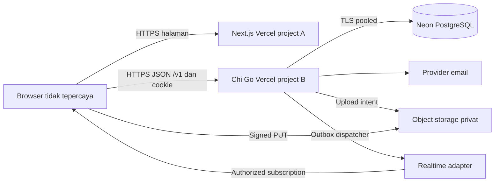
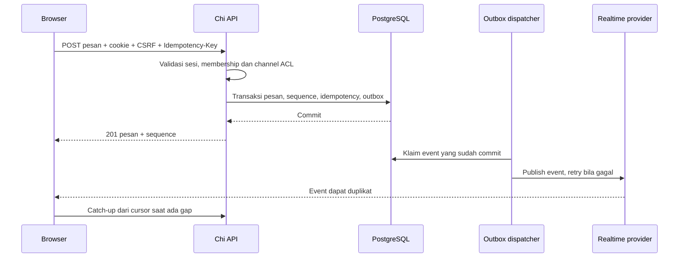

# Arsitektur dan keputusan

[Indeks](README.md) | [Modul](03-modul.md) | [Infrastruktur](08-infrastruktur.md)

## Sistem dan trust boundary

Subdomain usulan `app.example` dan `api.example` berada pada satu registrable site yang dikuasai operator. Domain dan region belum ditetapkan. Go Function memiliki satu HTTP entrypoint ke Chi; mount `/v1` dan rewrite Vercel harus dibuktikan via PoC. Browser adalah boundary tidak tepercaya; secret hanya di backend/CI. Preview memakai origin, OAuth client, DB branch, bucket dan secret terpisah.

Handler hanya mengurus HTTP; service menegakkan invariant dan mengoordinasikan transaksi; repository sqlc/pgx mengakses tabel milik modul; adapter email/media/realtime berada di luar domain. Modul tidak saling memanggil lewat HTTP internal. Outbox adalah at-least-once, bukan exactly-once.

## Decision records

| ID | Keputusan / alasan | Alternatif, trade-off, status |
|---|---|---|
| ADR-01 | Go + Chi modular monolith: satu deploy, boundary modul dan transaksi eksplisit. | Microservices menambah operasi dan distributed transaction. Ditetapkan brief; belum ada source backend. |
| ADR-02 | Neon PostgreSQL + pgx/sqlc/goose: integritas relasional, query bertipe, migrasi audit. | ORM menyembunyikan detail query; pooling dan cold start butuh pengukuran. Ditetapkan brief. |
| ADR-03 | REST `/v1`, JSON, OpenAPI contract-first, error standar dan cursor. | GraphQL meningkatkan kompleksitas query/authorization. OpenAPI aktual belum dibuat. |
| ADR-04 | Project Go terpisah; usulan API host-only cookie pada subdomain satu site. | BFF memudahkan cookie tetapi menambah hop dan boundary. Cross-site cookie rentan browser policy; perlu PoC domain/preview. |
| ADR-05 | DB source of truth, outbox dan adapter realtime eksternal. | WebSocket Go langsung pada Functions bisa mengurangi vendor namun runtime/upgrade, fan-out dan durasi belum terbukti. Polling fallback. |
| ADR-06 | Sesi opaque random, verifier di-hash, revocation server; OTP email dan OIDC. | JWT stateless mengurangi lookup namun memperumit revocation; tidak menyimpan token di localStorage. Usulan keamanan. |
| ADR-07 | Vercel Functions dan Neon sebagai target awal biaya rendah. | Server long-running/queue menambah biaya dan operasi, tetapi mungkin diperlukan setelah PoC. Jangan mengubah keputusan tanpa bukti. |

Request deadline lebih pendek dari batas function; pool acquisition/DB dibatasi deadline, error tidak membocorkan internals. Request ID terpisah dari user ID. UTC server sebagai waktu bisnis. Tidak ada in-memory session, rate limit global atau event bus sebagai sumber kebenaran lintas instance. Tidak ada panggilan vendor di dalam transaksi DB.

**Open questions:** domain produksi/preview, kepemilikan legal, komersial/nonkomersial, E2EE, retention, moderation, akses lintas tenant, volume dan SLA, provider email/storage/realtime, kompatibilitas Go/Chi dan region. Belum ada deployment dibuktikan.
