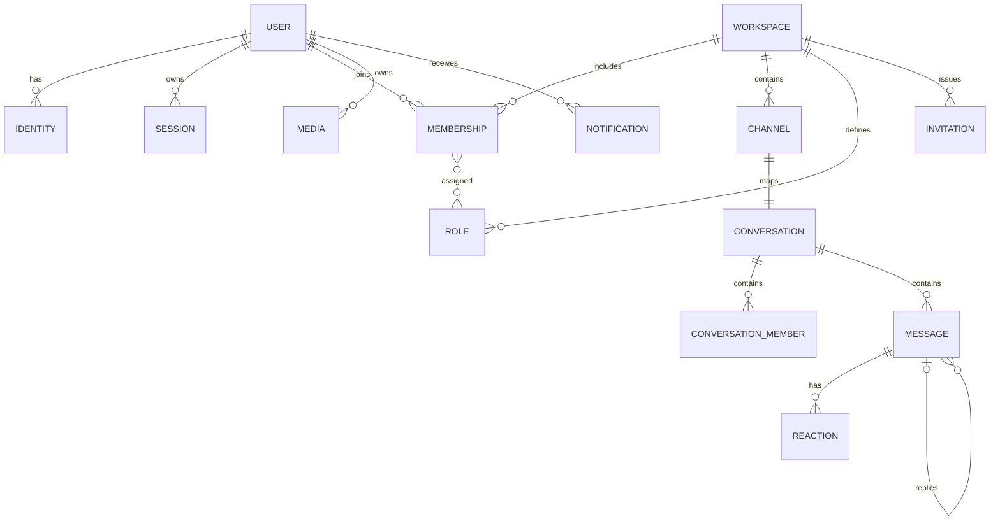

# Desain data PostgreSQL

[Indeks](README.md) | [Modul](03-modul.md) | [API](05-api.md)

Desain konseptual, bukan SQL/migrasi. ID usulan UUID acak dari server; waktu UTC server; semua FK dan tenant boundary ditegakkan DB dan service. Semua ukuran, TTL dan retention di bawah adalah usulan untuk dikonfirmasi.

ER ini konseptual: channel conversation menggunakan ACL workspace/channel; tabel conversation_member khusus DM. Banyak-ke-banyak role direalisasikan assignment table, bukan array bebas.

## Entitas dan constraint

| Entitas | Kolom penting dan integritas | Indeks / aturan |
|---|---|---|
| users | id PK, username asli+normalized, created_at, deleted_at, onboarding_completed_at | unique normalized username untuk user aktif; kebijakan reuse setelah deletion harus diputuskan. |
| identities | id, user_id FK, provider, provider_subject, verified_email_normalized, verified_at | unique(provider,subject); email bukan identity key Google; konflik email tidak otomatis merger. |
| otp_challenges | id, email normalized, code HMAC, key_version, expires_at, attempts, consumed_at, invalidated_at, created_at | index email+created_at; expiry, max attempts, send cooldown dan compare/consume di transaksi dengan lock. |
| sessions | id, user_id FK, verifier_hash, created_at, last_seen_at, idle_expires_at, absolute_expires_at, revoked_at, device_id FK nullable | index user_id+revoked_at; verifier secret tidak disimpan plaintext. |
| devices | id, user_id FK, label, coarse platform, UA ringkas, first_seen, last_seen | Metadata tidak membuktikan device; IP retention minimum dan akses terbatas. |
| profiles | user_id PK/FK, display_name, bio, avatar_media_id, banner_media_id, status, custom_status | FK media valid dan authorized; text length di API/DB. |
| workspaces | id, name, slug, description, owner_user_id FK, created_at, deleted_at | unique slug sesuai policy; ownership transfer atomic dengan membership. |
| memberships | id, workspace_id FK, user_id FK, state, nickname, display_title, avatar_media_id, joined_at, left_at | unique aktif(workspace,user), index user+state; owner harus membership aktif; last owner dicek transaction lock. |
| roles, role_capabilities, membership_roles | role id/workspace_id/name/system; capability registry; assignment membership_id+role_id | unique workspace+normalized role name, unique assignments; composite FK memastikan workspace sama. Display title terpisah. |
| categories, channels | category id/workspace/order; channel id/workspace/category, slug, name, visibility, position, deleted_at | unique workspace+slug aktif; composite FK pastikan category satu workspace; position tidak dijadikan message order. |
| channel_acl | channel_id, subject role/member, effect allow/deny, capability | unique subject/capability; FK tenant konsisten, deny precedence; akses default deny. |
| invitations | id, workspace_id, secret_hash, created_by, expires_at, max_uses, uses, revoked_at | unique secret_hash; uses<=max_uses; conditional update/row lock redemption. |
| conversations | id, kind dm/channel, workspace_id nullable, channel_id nullable, next_sequence, created_at | check tepat satu jenis, unique channel_id; DM pair key canonical unique; grup DM belum diputuskan. |
| conversation_members | conversation_id, user_id, joined_at, left_at, last_read_sequence | unique conversation/user; index user+activity; hanya DM. Channel read cursor butuh tabel cursor sendiri. |
| messages | id, conversation_id, sequence, author_id, kind, text, reply_to_id nullable, revision, created_at, edited_at, deleted_at | unique(conversation_id,sequence); index (conversation_id,sequence DESC); composite FK reply ke conversation yang sama. |
| message_reads | conversation_id, user_id, last_read_sequence, updated_at | unique(conversation_id,user); monotonic max setelah authorize, seq tidak lebih dari head; mendukung DM dan channel. |
| reactions, message_pins | message_id+user_id+emoji; pin message_id, pinned_by, created_at | unique reaction tuple, unique pin per message; FK + ACL saat read/write. |
| mentions | message_id, mentioned_user_id, position/meta | unique relevan; semua mention diverifikasi member dan akses ketika diterima. |
| media | id, owner_id, object_key, status pending/quarantined/ready/rejected/deleted, declared_type, detected_type, bytes, checksum, created_at | object_key unik acak; hanya ready dan authorized bisa di-attach; quota dan cleanup orphan. |
| stickers, packs | id, pack_id, media_id, status, attribution | immutable version/published flag; hak distribusi perlu diputuskan. |
| preferences | user_id PK, settings_version, notification/privacy/appearance fields, updated_at | default eksplisit, whitelist PATCH, version conflict saat concurrent edit. |
| notifications | id, user_id, kind, subject IDs, created_at, read_at, dedupe_key | unique(user_id,dedupe_key); index(user_id,created_at DESC,id DESC); jangan simpan konten rahasia yang tak lagi dapat diakses. |
| idempotency_keys | actor_id, scope, key_hash, request_hash, status, response_ref, expires_at | unique(actor_id,scope,key_hash), fingerprint wajib cocok; response direplay setelah commit. |
| event_streams | stream_id PK, next_event_sequence | Counter terpisah dari message sequence; lock sampai commit untuk mengurutkan seluruh mutasi dalam stream. |
| outbox_events | id, stream_id, stream_event_sequence, type, payload minimal, created_at, published_at, attempts, next_retry, lease_until | unique(stream_id,stream_event_sequence); index pending+retry; worker claim lease, retry dan dedupe consumer. Message sequence bukan event sequence. |
| user_event_streams, user_event_ledger | user_id, next_sequence; user_id+sequence, event_id, resource_ref, created_at | Kandidat untuk `/events`: alokasi per user harus commit-order-safe di bawah lock; unique(user_id,sequence), unique(user_id,event_id), index user+sequence. Belum production-ready sebelum PoC fan-out, retention dan ACL. |
| audit_events | id, actor_id nullable, target, action, reason, request_id, time | index workspace+time; redaksi token/OTP/konten; pembatasan akses dan retention. |

## Urutan, transaksi, concurrency

- Urutan pesan ditetapkan **per conversation** dengan counter row yang dikunci dan dinaikkan dalam transaksi; tidak bergantung UUID, timestamp, urutan penerimaan event atau `Date.now()`. Setiap write pesan, idempotency outcome dan outbox commit bersama.
- DM 1:1 menggunakan canonical ordered pair user ID + unique constraint. Dua request paralel harus menghasilkan conversation yang sama. Channel conversation memiliki satu row unik per channel.
- Invite redeem: lock invitation, cek secret hash, TTL/revocation/usage dan user eligibility; insert membership idempotent + increment use hanya ketika membership baru berhasil, dalam transaksi. Paralel tidak melebihi limit.
- Role/owner: lock workspace/membership sebelum perubahan, cek active membership, capability dan minimal satu owner secara atomik. Tidak mengandalkan dropdown UI.
- Read cursor server menerima sequence valid di conversation yang terlihat user; update menggunakan maksimum nilai lama dan baru. Jangan beranjak mundur karena request terlambat; tetapkan perilaku nilai masa depan secara eksplisit sebagai 422.
- Idempotency scope `actor + operation + key`, TTL usulan 24 jam; body fingerprint sama -> respons asli, beda -> 409; request concurrent diserialkan/409 retry. Kegagalan sebelum commit tidak menyimpan sukses palsu.

## Pagination, pencarian dan penghapusan

Keyset cursor opaque bertanda tangan/tervalidasi dengan scope dan `(sequence)` untuk messages, `(created_at,id)` untuk daftar. Limit default usulan 30, maksimum 100; filter ACL **sebelum** limit dan count. Cursor bukan otorisasi. Search full-text/ILIKE parameterized hanya setelah ACL; mulai dengan index sesuai EXPLAIN, bukan indeks spekulatif.

Message delete awal diusulkan soft-delete/tombstone agar urutan/reply konsisten; isi harus dihapus sesuai retention dan kebijakan privasi, bukan disembunyikan tanpa batas. Akun/workspace soft-delete sementara untuk recovery lalu hard-delete/anonymization terjadwal dengan FK strategy, media dan backup retention terdokumentasi. Audit metadata dan isi pesan memiliki aturan berbeda. Legal hold dan durasi retensi **belum ditetapkan**.

## Migrasi dan backup

Goose versioned, immutable setelah diterapkan; expand -> deploy kompatibel lama/baru -> backfill terukur -> switch -> contract. Migrasi memakai koneksi direct yang sesuai, satu migrator ber-lock; jangan menjalankan dari setiap cold start. sqlc dan pgx diuji untuk versi PgBouncer/Neon yang dipakai; prepared statement/session state harus diverifikasi. Uji rollback atau forward-fix di branch staging; backup + restore drill sebelum perubahan destruktif. Tidak ada migrasi yang dibuat sekarang.
