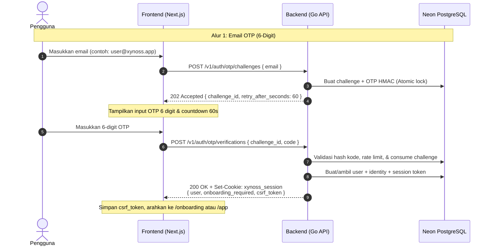
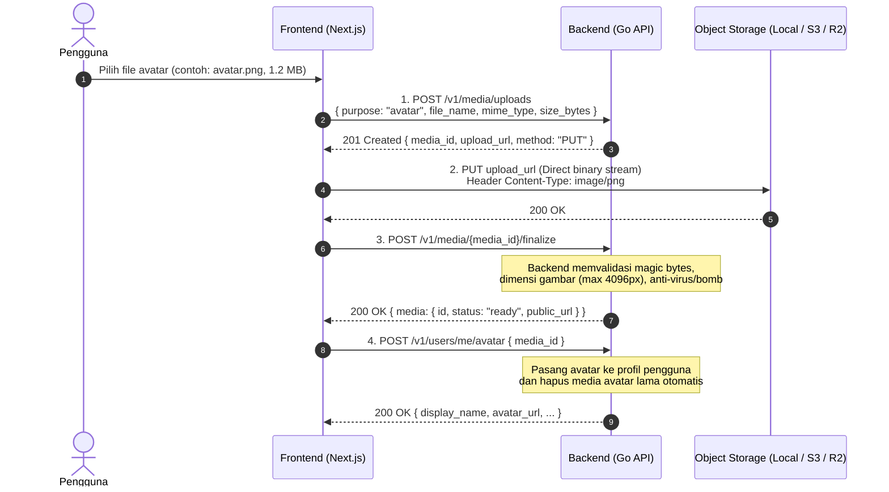

# XYNOSS RELAY — FRONTEND INTEGRATION CONTRACT & GUIDE (Codex AI)

> **Untuk:** Tim Frontend Engineer (Codex AI)  
> **Dari:** Principal Backend Engineer (Go Backend Team)  
> **Status:** Backend Production-Ready (Pass All Tests & Neon DB Integration)  
> **Target Aplikasi:** `apps/client` (Next.js)  
> **Backend Service:** `services/api` (Go / Chi / Neon PostgreSQL)

Dokumen ini adalah kontrak teknis resmi dan panduan integrasi frontend (`apps/client`) dengan backend XYNOSS Relay (`services/api`). Semua endpoint yang dijelaskan di bawah ini telah diimplementasikan, diuji secara menyeluruh (*unit tests* & *live integration test* terhadap Neon PostgreSQL), dan siap dikonsumsi oleh frontend.

---

## 1. Lingkungan & Base URL

### Base URL
- **Local Development:** `http://localhost:8080/v1`
- **Production (Vercel):** `https://<backend-deployment-domain>/v1`

### Format Header & Request
Semua request ke backend harus menggunakan format standar berikut:
```http
Content-Type: application/json
Accept: application/json
```

### Konfigurasi `.env.local` pada `apps/client`
Tambahkan konfigurasi berikut pada file environment frontend:
```env
NEXT_PUBLIC_API_URL=http://localhost:8080/v1
```
> [!CAUTION]
> **JANGAN PERNAH** menaruh secret keys backend, Google Client Secret, atau `INTERNAL_API_KEYS` ke dalam frontend `.env.local`. Frontend hanya membutuhkan `NEXT_PUBLIC_API_URL`.

---

## 2. Standar Response & Error Handling

### Standar Response Berhasil
Semua endpoint mengembalikan envelope JSON dengan key `data`:
```json
{
  "data": {
    "user": {
      "id": "1d8eb96b-67df-44fe-a28a-668b5774a387",
      "display_name": "Alex Mercer"
    }
  }
}
```
Untuk operasi penghapusan sukses (*revoke session*, *delete avatar*, *logout*), backend mengembalikan HTTP status `204 No Content` tanpa body.

### Standar Response Error
Jika terjadi kegagalan atau validasi tidak lolos, backend mengembalikan format error terpadu:
```json
{
  "error": {
    "code": "VALIDATION_ERROR",
    "message": "Format data yang dikirimkan tidak valid",
    "details": [
      {
        "field": "username",
        "code": "INVALID_FORMAT",
        "message": "Username hanya boleh berupa huruf, angka, dan underscore (3-32 karakter)"
      }
    ],
    "request_id": "c1f7a0b2-4d2b-4d43-98fe-89291129f109"
  }
}
```

### Kode Error Standar
| HTTP Status | Error Code | Keterangan |
|---|---|---|
| `400` | `BAD_REQUEST` | Request payload malformed atau JSON parsing gagal |
| `401` | `UNAUTHENTICATED` | Sesi tidak valid, sudah kadaluarsa, atau belum login |
| `403` | `FORBIDDEN` / `INVALID_CSRF_TOKEN` | Akses ditolak atau token CSRF tidak cocok/hilang |
| `404` | `NOT_FOUND` | Resource (user, sesi, media) tidak ditemukan |
| `409` | `CONFLICT` / `USERNAME_ALREADY_TAKEN` | Data konflik (misal: username sudah dipakai pengguna lain) |
| `412` | `REVISION_MISMATCH` | Versi profil tidak cocok (*optimistic concurrency conflict*) |
| `422` | `VALIDATION_ERROR` | Validasi field gagal |
| `429` | `RATE_LIMITED` | Batas frekuensi request terlampaui (cek header `Retry-After`) |
| `500` | `INTERNAL_SERVER_ERROR` | Kesalahan internal server |

---

## 3. Aturan Kredensial, Cookies & CSRF Protection

### 3.1. Credentials Mode (Wajib)
Backend menggunakan **HTTP-only Secure Cookie**:
- Local Development: `xynoss_session`
- Production: `__Host-xynoss_session`

Setiap pemanggilan API dari frontend menggunakan `fetch` atau Axios **WAJIB** menyertakan mode credentials:
```typescript
// Menggunakan native fetch
const res = await fetch(`${process.env.NEXT_PUBLIC_API_URL}/me`, {
  credentials: 'include', // WAJIB agar cookie sesi terkirim
  headers: {
    'Accept': 'application/json'
  }
});

// Menggunakan Axios
axios.defaults.withCredentials = true;
```

### 3.2. CSRF Token Protection
Untuk melindungi dari serangan Cross-Site Request Forgery (CSRF), backend mewajibkan header `X-CSRF-Token` pada **semua request yang mengubah data (`POST`, `PUT`, `PATCH`, `DELETE`)** ketika pengguna sudah login melalui cookie.

- Nilai `csrf_token` didapatkan saat:
  1. Berhasil verifikasi OTP (`POST /v1/auth/otp/verifications`)
  2. Melakukan bootstrap sesi (`GET /v1/auth/session`)
- Simpan `csrf_token` di memory state React / Zustand / TanStack Query (bukan di localStorage jika ingin maksimal keamanannya).
- Sertakan header `X-CSRF-Token`:
```typescript
await fetch(`${process.env.NEXT_PUBLIC_API_URL}/me/profile`, {
  method: 'PATCH',
  credentials: 'include',
  headers: {
    'Content-Type': 'application/json',
    'X-CSRF-Token': currentCsrfToken // WAJIB untuk metode POST/PUT/PATCH/DELETE
  },
  body: JSON.stringify({ display_name: 'Alex' })
});
```

---

## 4. Alur Autentikasi (Authentication Flows)

XYNOSS Relay mengadopsi prinsip **Passwordless Only** (Email OTP 6-Digit & Google OAuth). Tidak ada password biasa.



### 4.1. Minta Kode OTP
- **Endpoint:** `POST /v1/auth/otp/challenges`
- **Auth:** Publik
- **Request Body:**
```json
{
  "email": "user@example.com"
}
```
- **Response (202 Accepted):**
```json
{
  "data": {
    "challenge_id": "b8a8b163-95ec-45c1-925a-cf2a537f8fbf",
    "retry_after_seconds": 60
  }
}
```
> [!NOTE]
> Backend mengimplementasikan **Anti-Account Enumeration**. Response `202 Accepted` akan selalu dikembalikan baik email tersebut pengguna baru maupun lama, sehingga penyerang tidak bisa mendeteksi keberadaan akun.

### 4.2. Verifikasi Kode OTP
- **Endpoint:** `POST /v1/auth/otp/verifications`
- **Auth:** Publik
- **Request Body:**
```json
{
  "challenge_id": "b8a8b163-95ec-45c1-925a-cf2a537f8fbf",
  "code": "847291"
}
```
- **Response (200 OK):**
```json
{
  "data": {
    "user": {
      "id": "7f8b9e11-64d1-44ef-a28a-668b5774a387",
      "display_name": "user",
      "username": "user_7f8b9e11",
      "avatar_url": null
    },
    "onboarding_required": true,
    "csrf_token": "a4f89b2c3d4e5f6a..."
  }
}
```
*Catatan: Backend akan otomatis menyertakan header `Set-Cookie: xynoss_session=...; HttpOnly; SameSite=Lax`.*

### 4.3. Google OAuth 2.0 / OIDC
- **Mulai Autentikasi Google:** Arahkan window / browser pengguna ke:
  ```http
  GET /v1/auth/google/start?redirect_uri=http://localhost:3000/auth/callback
  ```
- Backend akan membuat cryptographically signed state token, PKCE code challenge, dan melakukan 302 Redirect ke Google Login Consent Screen.
- Setelah login di Google, Google akan me-redirect pengguna ke:
  ```http
  GET /v1/auth/google/callback?code=...&state=...
  ```
- Backend menukar authorization code, memvalidasi state, membuat session cookie, dan me-redirect pengguna kembali ke frontend (`/app` atau URL asal).

### 4.4. Bootstrap Sesi Saat Membuka Aplikasi
Panggil endpoint ini saat pertama kali aplikasi dibuka / reload untuk memeriksa apakah user sudah login:
- **Endpoint:** `GET /v1/auth/session`
- **Auth:** Membutuhkan Cookie Sesi
- **Response (200 OK):**
```json
{
  "data": {
    "user": {
      "id": "7f8b9e11-64d1-44ef-a28a-668b5774a387",
      "display_name": "Alex Mercer",
      "username": "alexmercer",
      "avatar_url": "https://..."
    },
    "onboarding_required": false,
    "csrf_token": "b9f28a7e4..."
  }
}
```
Jika cookie tidak ada atau expired, backend mengembalikan `401 UNAUTHENTICATED`.

### 4.5. Logout
- **Endpoint:** `POST /v1/auth/logout`
- **Auth:** Membutuhkan Cookie Sesi + Header `X-CSRF-Token`
- **Response (204 No Content):** Cookie sesi dihapus dan sesi di database dicabut (*revoked*).

---

## 5. Profil Pengguna & Onboarding

### 5.1. Ambil Profil Saya (`GET /v1/me`)
- **Endpoint:** `GET /v1/me`
- **Response (200 OK):**
```json
{
  "data": {
    "user": {
      "id": "7f8b9e11-64d1-44ef-a28a-668b5774a387",
      "system_role": "user",
      "created_at": "2026-11-08T10:00:00Z"
    },
    "profile": {
      "display_name": "Alex Mercer",
      "username": "alexmercer",
      "bio": "Building realtime communications.",
      "avatar_media_id": "media-uuid-1",
      "banner_media_id": null,
      "avatar_url": "http://localhost:8080/v1/media/content/media-uuid-1.png",
      "banner_url": null,
      "availability": "online",
      "custom_status": "Coding in Go",
      "revision": 2
    },
    "identities": [
      {
        "provider": "email",
        "identifier": "alex@xynoss.app"
      }
    ],
    "onboarding_completed": true
  }
}
```

### 5.2. Selesaikan Onboarding (`POST /v1/me/onboarding/complete`)
Jika `onboarding_required: true`, arahkan user ke form onboarding dan kirimkan:
- **Endpoint:** `POST /v1/me/onboarding/complete`
- **Headers:** `X-CSRF-Token: <token>`
- **Request Body:**
```json
{
  "display_name": "Alex Mercer",
  "username": "alexmercer"
}
```
- **Aturan Validasi Username:**
  - Panjang: 3 - 32 karakter
  - Pola Regex: `^[a-zA-Z0-9_]{3,32}$` (hanya huruf, angka, underscore)
  - Unik (mengembalikan `409 CONFLICT` jika sudah diambil).

### 5.3. Update Profil (`PATCH /v1/me/profile`)
- **Endpoint:** `PATCH /v1/me/profile`
- **Headers:**
  - `X-CSRF-Token: <token>` (Wajib)
  - `If-Match: "2"` (Opsional tapi direkomendasikan untuk mencegah overwrite versi sebelumnya)
- **Request Body (Semua field opsional, kirim field yang ingin diubah):**
```json
{
  "display_name": "Alex Mercer",
  "bio": "Minimalist messenger architect.",
  "availability": "focus",
  "custom_status": "Do Not Disturb"
}
```
- **Response (200 OK):** Mengembalikan data profil yang telah diperbarui beserta nomor `revision` terbaru.

---

## 6. Alur Upload Media (Avatar & Profile Banner)

Untuk menjamin performa tinggi dan keamanan, upload media menggunakan arsitektur **Direct-to-Storage with Intent and Finalize**. Frontend tidak mengunggah file multi-megabyte langsung ke server backend sebagai multipart form, melainkan melalui 4 langkah aman berikut:



### 6.1. Langkah 1: Minta Intent Upload
- **Endpoint:** `POST /v1/media/uploads`
- **Headers:** `X-CSRF-Token: <token>`
- **Request Body:**
```json
{
  "purpose": "avatar",
  "file_name": "my-photo.png",
  "mime_type": "image/png",
  "size_bytes": 1048576
}
```
*Batasan File:*
- **Format yang diizinkan:** `image/jpeg`, `image/png`, `image/webp`. File SVG/HTML/executable **DITOLAK**.
- **Batas Ukuran:** Avatar maksimal **5 MB**; Banner maksimal **10 MB**.
- **Dimensi:** Maksimal **4096 x 4096 piksel**.

- **Response (201 Created):**
```json
{
  "data": {
    "media_id": "e2a4b891-1123-44f2-a101-99228833aabb",
    "upload_url": "http://localhost:8080/v1/media/content/upload?key=media/avatar/....&sig=...",
    "method": "PUT",
    "headers": {
      "Content-Type": "image/png"
    },
    "expires_at": "2026-11-08T10:15:00Z"
  }
}
```

### 6.2. Langkah 2: Upload Binary Langsung ke `upload_url`
Frontend mengirim file langsung via HTTP `PUT` ke `upload_url`:
```typescript
const uploadRes = await fetch(uploadData.upload_url, {
  method: uploadData.method, // 'PUT'
  headers: {
    'Content-Type': file.type // 'image/png'
  },
  body: file // File atau Blob mentah
});

if (!uploadRes.ok) {
  throw new Error('Gagal mengunggah file ke storage');
}
```

### 6.3. Langkah 3: Finalisasi Media
Setelah upload binary berhasil, panggil finalize untuk menginstruksikan backend melakukan verifikasi file sniffing dan dimensi:
- **Endpoint:** `POST /v1/media/{media_id}/finalize`
- **Headers:** `X-CSRF-Token: <token>`
- **Response (200 OK):**
```json
{
  "data": {
    "media": {
      "id": "e2a4b891-1123-44f2-a101-99228833aabb",
      "status": "ready",
      "mime_type": "image/png",
      "size_bytes": 1048576,
      "public_url": "http://localhost:8080/v1/media/content/media/avatar/..."
    }
  }
}
```

### 6.4. Langkah 4: Tautkan Media ke Avatar atau Banner
- **Pasang Avatar:** `POST /v1/users/me/avatar`
  - **Headers:** `X-CSRF-Token: <token>`
  - **Body:** `{"media_id": "e2a4b891-1123-44f2-a101-99228833aabb"}`
- **Pasang Banner:** `POST /v1/users/me/banner`
  - **Headers:** `X-CSRF-Token: <token>`
  - **Body:** `{"media_id": "..."}`
- **Hapus Avatar:** `DELETE /v1/users/me/avatar` (204 No Content)
- **Hapus Banner:** `DELETE /v1/users/me/banner` (204 No Content)

---

## 7. Manajemen Perangkat & Sesi (Device Management)

Pengguna dapat melihat seluruh perangkat aktif yang sedang login dan mencabut akses (*revoke*) pada perangkat yang tidak dikenal:

### 7.1. Daftar Sesi Aktif
- **Endpoint:** `GET /v1/me/sessions`
- **Response (200 OK):**
```json
{
  "data": {
    "sessions": [
      {
        "id": "89b12a34-...",
        "device_name": "Chrome on Windows",
        "device_type": "desktop",
        "ip_address": "127.0.0.1",
        "is_current": true,
        "last_active_at": "2026-11-08T10:05:00Z",
        "expires_at": "2026-12-08T10:05:00Z"
      },
      {
        "id": "77c22b11-...",
        "device_name": "Mobile Safari on iOS",
        "device_type": "mobile",
        "ip_address": "114.122.5.12",
        "is_current": false,
        "last_active_at": "2026-11-07T18:22:00Z",
        "expires_at": "2026-12-07T18:22:00Z"
      }
    ]
  }
}
```

### 7.2. Cabut Akses Sesi Tertentu
- **Endpoint:** `DELETE /v1/me/sessions/{session_id}`
- **Headers:** `X-CSRF-Token: <token>`
- **Response (204 No Content)**
> [!NOTE]
> Jika user mencabut sesi yang sedang aktif saat ini (`is_current: true`), cookie sesi juga otomatis di-clear dan user diarahkan ke layar login.

---

## 8. Contoh Implementasi API Client Helper (TypeScript)

Berikut adalah contoh helper client terstruktur yang dapat disalin langsung oleh Codex AI ke `apps/client/lib/api-client.ts`:

```typescript
// apps/client/lib/api-client.ts

const API_BASE_URL = process.env.NEXT_PUBLIC_API_URL || 'http://localhost:8080/v1';

let cachedCsrfToken: string | null = null;

export function setCsrfToken(token: string | null) {
  cachedCsrfToken = token;
}

export function getCsrfToken(): string | null {
  return cachedCsrfToken;
}

export interface ApiErrorResponse {
  error: {
    code: string;
    message: string;
    details?: Array<{ field: string; code: string; message: string }>;
    request_id?: string;
  };
}

export async function apiClient<T>(
  endpoint: string,
  options: RequestInit = {}
): Promise<T> {
  const url = `${API_BASE_URL}${endpoint.startsWith('/') ? endpoint : `/${endpoint}`}`;
  
  const headers = new Headers(options.headers || {});
  headers.set('Accept', 'application/json');
  
  if (options.body && typeof options.body === 'string' && !headers.has('Content-Type')) {
    headers.set('Content-Type', 'application/json');
  }

  // Wajib kirim X-CSRF-Token untuk metode mutasi
  const method = (options.method || 'GET').toUpperCase();
  if (['POST', 'PUT', 'PATCH', 'DELETE'].includes(method) && cachedCsrfToken) {
    headers.set('X-CSRF-Token', cachedCsrfToken);
  }

  const response = await fetch(url, {
    ...options,
    headers,
    credentials: 'include', // Selalu kirim/terima secure session cookie
  });

  if (response.status === 204) {
    return {} as T;
  }

  const json = await response.json();

  if (!response.ok) {
    throw json as ApiErrorResponse;
  }

  // Simpan CSRF token jika response menyediakannya (misal pada verify OTP / bootstrap session)
  if (json.data && json.data.csrf_token) {
    setCsrfToken(json.data.csrf_token);
  }

  return json.data as T;
}
```

---

## 9. Checklist Kesiapan Integrasi Codex AI
- [x] Backend local server berjalan di port `8080`.
- [x] CORS terkonfigurasi untuk menerima origin `http://localhost:3000` dengan `credentials: true`.
- [x] Database Neon PostgreSQL live dengan 19 tabel termigrasi lengkap.
- [x] Rate limiter aktif (IP-based dan email cooldown).
- [x] Proteksi Anti-CSRF aktif dan terverifikasi.
- [x] Pengujian validasi ukuran dan sanitasi gambar media 100% lolos.
